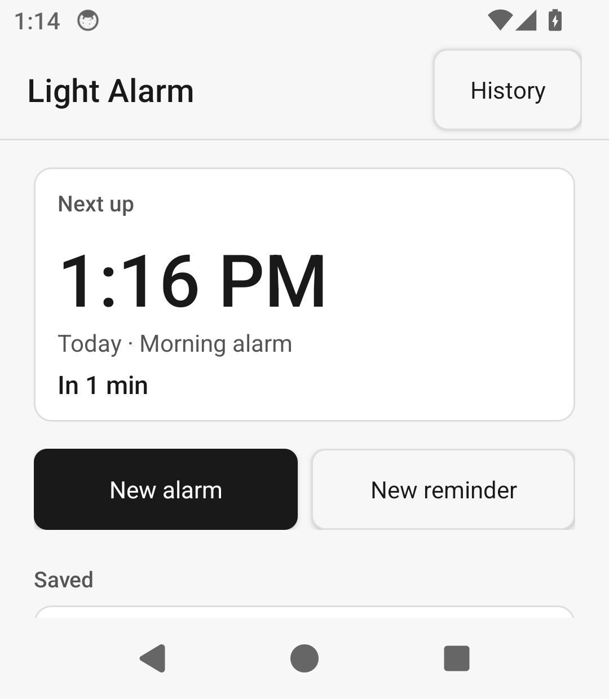

# Light Alarm

An offline alarm and reminder app for the Light Phone III. The APK uses Android platform views and generated tones. It has no network permission or native libraries.

## Build

Use JDK 17 and Android SDK 36. Set `ANDROID_HOME` to the SDK location.

```sh
./gradlew :app:assembleRelease
```

The unsigned APK is in `app/build/outputs/apk/release/`. Align and sign it with the app's release certificate. Keep the signing key outside the repository.

## Install and verify

Install the signed APK through Tool Manager with third-party APKs allowed. If LightOS asks for a developer fingerprint, use the SHA-256 certificate fingerprint supplied with the release. Enable alarm notifications and grant full-screen alerts if your phone offers that control. Set a near-term test alarm and lock the physical phone to validate ringing and audio output.

The app re-arms future alarms after Android's normal boot-completed broadcast, which can require the first unlock. The rolling history view excludes entries older than 24 hours, and an Android maintenance alarm prunes old records when the system delivers it.

## Release

Get the [signed APK from Releases](https://github.com/Toruk-Machto/light-alarm/releases/latest) and install it through Tool Manager. Light Alarm v0.1.1 was tested with the physical Light Phone III locked. The interface uses neutral grayscale. A short locked-screen test on your own phone confirms its notification and full-screen settings.

Light Alarm keeps alarms and reminders on the phone. The app excludes entries older than 24 hours from its history and has no Internet permission.

 
