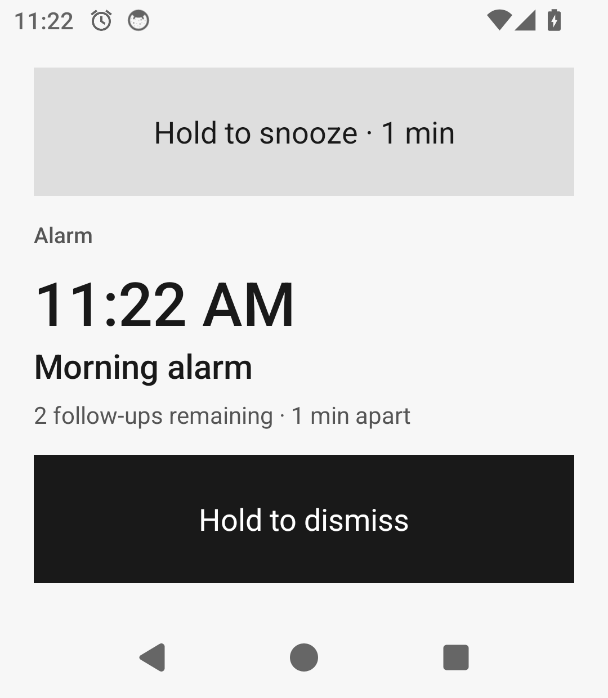

# Light Alarm

An offline alarm and reminder app for the Light Phone III. The APK uses Android platform views and generated tones. It has no network permission or native libraries.

## Build

Use JDK 17 and Android SDK 36. Set `ANDROID_HOME` to the SDK location.

```sh
./gradlew :app:assembleRelease
```

The unsigned APK is in `app/build/outputs/apk/release/`. Align and sign it with the app's release certificate. Keep the signing key outside the repository.

## Install and verify

Install the signed APK through Tool Manager with third-party APKs allowed. If LightOS asks for a developer fingerprint, use the SHA-256 certificate fingerprint supplied with the release. Enable alarm notifications and grant full-screen alerts if your phone offers that control. Set a near-term test alarm and lock the physical phone to validate ringing and audio output.

The app re-arms future alarms after Android's normal boot-completed broadcast, which can require the first unlock. The rolling history view excludes entries older than 24 hours, and an Android maintenance alarm prunes old records when the system delivers it.

## Release

Get the [signed APK from Releases](https://github.com/Toruk-Machto/light-alarm/releases/latest) and install it through Tool Manager. Light Alarm v0.1.1 was tested with the physical Light Phone III locked. The interface uses neutral grayscale. A short locked-screen test on your own phone confirms its notification and full-screen settings.

Light Alarm keeps alarms and reminders on the phone. The app excludes entries older than 24 hours from its history and has no Internet permission.

 

## Battery update

Version 0.1.2 preserves the alarm controls and grayscale interface while bounding ring duration across clock changes and releasing unnecessary CPU wake locks for silent reminders. See [BATTERY_UPDATE.md](BATTERY_UPDATE.md) for behavior and emulator verification.

## Version 0.2.0

- One shared time for selected weekdays, with compact day buttons. Existing different weekday times remain until a shared time is chosen.
- Separate top Snooze and bottom Dismiss controls require a continuous 1.5-second hold. Releasing early, moving outside, switching alarms or leaving the screen cancels the hold.
- Per-alarm volume (10–100%, default 100%) temporarily raises the alarm audio stream and restores its previous level. Ring/silent mode and Do Not Disturb are not changed. Silent tones remain silent.
- Twelve generated sounds: soft bells, pulse, bright chime, gentle rain, ocean waves, birdsong, wind chimes, warm bell, marimba, classic bell, urgent pulse and rising beacon.
- A single Follow-ups page replaces retry/backup options. Choose 0–15 additional rings and a 1–60 minute gap. One snooze queues the remaining sequence; another snooze delays only the remaining rings. Dismiss cancels the occurrence's sequence.
- “Also repeat if unanswered” is enabled by default for new alarms, and can be changed per alarm. The gap must be at least the selected ring duration.

Generated nature sounds are synthesized, not field recordings. No audio downloads or network access are required.

Existing retry/backup settings migrate to follow-ups with a review notice. Already scheduled legacy retry/backup events are kept for the current occurrence until it ends or is dismissed; subsequent occurrences use the new settings. Other recurring schedules, pre-alarms, reminders, privacy and 24-hour history remain available.

### Verification

JDK 17 unit tests cover recurrence, time zones, daylight saving and all generated sounds. `EngineChecks` on the Android 14 ARM64 Light Phone III emulator covers shared times, migration, automatic follow-ups, repeated snoozes, limits, independent overlapping alarms, clock changes, persistence, reboot recovery, volume restoration, DND and hold cancellation. Real timed lock-screen sequences and release-upgrade checks supplement these tests. Confirm the new volume behavior on a physical Light Phone III before relying on it; LightOS audio behavior can differ from the emulator.
